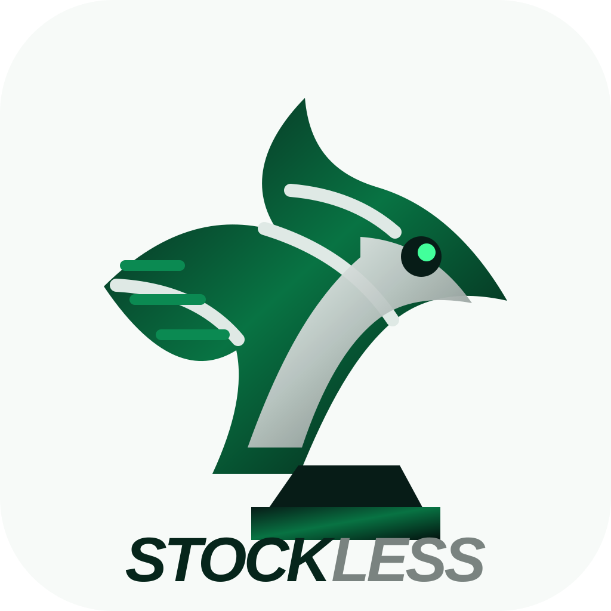

# Stockless — Hybrid Chess Engine

<p align="center"></p>

**English** | [한국어](#한국어)

> Stockless combines Stockfish's established C++ engine infrastructure with a separately developed, threat-aware search policy informed by selected Reckless research. It is **not** a 50/50 source-code merge or a simple average of two NNUE networks.

**Repository:** https://github.com/gaong5247-cmd/Stockless

**Version note:** The checked-in implementation currently identifies itself as **0.5-dev** (`src/stockless/config.h` and `tools/materialize.py`). Earlier README material referenced 0.3-dev. External mentions of 0.6 do not, by themselves, establish that the main-branch source implements 0.6. Refer to release tags and artifacts for published versions.

## Architecture

| Layer | Implementation / responsibility |
| --- | --- |
| Board, legal move generation, UCI, threading/NUMA, transposition table, Syzygy | Stockfish |
| Iterative deepening, root search, aspiration windows, primary NNUE evaluation | Stockfish |
| Research references for reductions, correction history, threat features | Reckless 0.10-dev |
| Threat extraction, hybrid depth decisions, selective overdrive, mobile tuning | Stockless |

Stockless pins upstream source revisions as Git submodules rather than merging the C++ and Rust projects line by line. See [upstream revisions](docs/UPSTREAM.md) and [architecture](docs/ARCHITECTURE.md).

### Search pipeline

```text
UCI GUI / command line
        |
Stockfish position, move generation, search and NNUE
        |
Stockless threat signals (selected nodes)
        |-- AttackPressure
        |-- KingDanger
        |-- TacticalVolatility
        |
Stockless hybrid search policy
        |-- LMR adjustment
        |-- Selective pruning-depth boost
        |-- Optional re-search depth bonus
        |
Stockfish search continues and returns bestmove
```

### Threat analysis

`src/stockless/threat_signal.h` uses Stockfish attack maps, king-zone contacts, attacked pieces and pins to compute three bounded signals (0–256):

- **Attack pressure:** contacts near the opposing king, attacks on opposing pieces and pins created.
- **King danger:** threats around our king, attacks on our pieces and pins suffered.
- **Tactical volatility:** mutual piece attacks, pins and king-zone contacts.

These are inexpensive **hand-engineered search signals, not outputs from a second full NNUE**. To limit overhead, ordinary shallow nodes may skip computation: the threshold is depth 5 on desktop and depth 7 in the mobile profile, while important nodes are eligible earlier.

### Hybrid depth policy

`src/stockless/search_policy.h` combines threat signals with search context: checks, captures, PV/TT-PV status, cut nodes, improvement, correction signal and cutoff history. The resulting tactical score influences how much late-move reduction (LMR) is bought back. Strong tactical situations may therefore receive deeper investigation; quiet cut nodes remain more conservative.

**Selective Overdrive** is optional and off by default. It targets forcing checks, severe king danger and high-pressure captures, rather than globally relaxing quiet-move pruning. Mobile mode applies a lower-cost policy. Turning off `StocklessHybrid` disables Stockless policy adjustments for comparison with the underlying Stockfish search.

### NNUE design

Stockfish supplies the **primary evaluation score**. Reckless's threat accumulator and feature design are research references. The current implementation does **not** run two complete NNUE evaluators on every node or claim to have merged their weights. A shared-feature, multi-head Stockless network is a longer-term design goal, not a shipped feature.

## Build

```bash
git clone --recurse-submodules https://github.com/gaong5247-cmd/Stockless.git
cd Stockless
python tools/materialize.py
make -C build/stockless-src/src -j build ARCH=x86-64-avx2
```

On Windows, use `./scripts/build-windows.ps1` in PowerShell. The materialization script checks pinned upstream commits, copies the Stockfish tree, injects Stockless headers and search/UCI changes, and produces buildable sources under `build/stockless-src/`. It fails if expected patch anchors or upstream revisions do not match. Choose an architecture supported by your CPU and toolchain.

## UCI options

| Option | Default | Meaning |
| --- | --- | --- |
| `StocklessHybrid` | true | Enable hybrid search adjustments |
| `StocklessAggression` | 145 | Hybrid aggression, range 0–200 |
| `StocklessThreats` | true | Enable board-derived threat signals |
| `StocklessOverdrive` | false | Opt-in selective tactical extensions |
| `StocklessMobile` | true on Android; false elsewhere | Lower-cost search profile |

Example:

```text
uci
setoption name StocklessAggression value 145
setoption name StocklessOverdrive value false
isready
position startpos
go depth 12
```

## Tests and evidence

The repository includes GitHub Actions build and arena workflows, Cute Chess scripts and [tuning notes](docs/TUNING_RESULTS.md). Reported Elo values are **relative to each specific opponent, time control and test configuration**, not universal ratings.

Examples documented in the repository:
- v0.3 vs Stockfish: 1,200 games, 48.25% score, approximately −12.2 relative Elo (95% CI −27.8 to +3.4).
- v0.3 vs Reckless 0.10-dev: 1,000 games at 1+0.01, 54.40% score, approximately +30.65 relative Elo.
- v0.4 aggression 144 confirmation: 4,000 games, 50.262% score, approximately +1.82 relative Elo (95% CI −7.22 to +10.87).
- v0.5 selective-overdrive aggression 145 fine sweep: 600 games, 52.17% score, approximately +15.1 relative Elo; a larger confirmation was described as pending.

**These results do not establish a statistically confirmed advantage over Stockfish.** Review the exact settings and confidence intervals before interpreting them. A release announcement or external blog listing is not independent strength validation.

## Project layout

```text
src/stockless/config.h          UCI-linked runtime settings
src/stockless/threat_signal.h   Board-based threat features
src/stockless/search_policy.h  Hybrid search decisions
tools/materialize.py            Reproducible source overlay
upstream/stockfish/             Pinned Stockfish submodule
upstream/reckless/              Pinned Reckless research submodule
scripts/                       Build and match helpers
.github/workflows/              CI, builds, tuning and arenas
docs/                           Architecture, upstream, tuning, Android
assets/stockless-logo.svg       Project branding
```

## Licensing and attribution

See [LICENSE](LICENSE), [NOTICE.md](NOTICE.md) and [UPSTREAM.md](docs/UPSTREAM.md). Stockfish is GPL-3.0-or-later; Reckless is AGPL-3.0; Stockless integration is distributed under AGPL-3.0. Preserve upstream notices and comply with applicable source-distribution obligations.

---

# 한국어

> Stockless는 Stockfish의 안정적인 C++ 엔진 기반 위에 Reckless의 연구 아이디어를 참고한 **독립적인 전술 인식형 탐색 정책**을 추가한 하이브리드 체스 엔진입니다. 두 엔진의 코드를 단순히 반반 합치거나 NNUE 가중치를 평균 낸 구조가 아닙니다.

**버전 안내:** 현재 main 브랜치의 `config.h`와 `materialize.py`는 **0.5-dev**를 명시합니다. 기존 README의 0.3-dev 표기와 외부 사이트의 0.6 소개는 실제 소스 버전과 구별해야 합니다. 공개 릴리스 버전은 태그 및 빌드 산출물을 기준으로 확인하세요.

## 구성 요소

| 계층 | 담당 |
| --- | --- |
| 체스판 표현, 합법 수 생성, UCI, 스레드/NUMA, TT, Syzygy | Stockfish |
| 반복 심화, 루트 탐색, aspiration window, 기본 NNUE 평가 | Stockfish |
| LMR, correction history, 위협 특성 연구 참고 | Reckless 0.10-dev |
| 위협 신호, 하이브리드 깊이 조절, 선택적 Overdrive, 모바일 프로필 | Stockless |

Stockless는 Stockfish와 Reckless를 Git 서브모듈의 고정 커밋으로 관리합니다. Reckless의 Rust 소스를 C++ 소스와 무작정 섞는 방식이 아니라, 필요한 개념을 선별적으로 적용하는 구조입니다.

## 핵심 동작

**1. 위협 신호 계산:** `threat_signal.h`는 Stockfish의 공격 비트보드와 킹 주변 공격, 공격받는 기물, 핀 정보를 사용하여 세 가지 신호를 계산합니다.

- **AttackPressure(공격 압박):** 상대 킹 주변 공격, 상대 기물 공격, 우리가 만든 핀
- **KingDanger(킹 위험도):** 우리 킹 주변 위협, 우리 기물에 대한 공격, 당한 핀
- **TacticalVolatility(전술적 변동성):** 상호 공격과 핀, 양측 킹 주변 접촉

각 값은 0~256 범위로 제한됩니다. 이 신호는 **두 번째 NNUE 추론 결과가 아니라 체스판 정보에서 계산한 경량 지표**입니다. 연산 비용을 줄이기 위해 일반 노드는 데스크톱에서 깊이 5, 모바일에서 깊이 7 미만일 경우 계산을 건너뛸 수 있습니다. 중요한 노드는 예외입니다.

**2. 하이브리드 탐색 정책:** `search_policy.h`는 위협 신호에 체크, 캡처, PV 노드, cut node, correction signal 등 탐색 정보를 결합합니다. 전술적으로 중요한 수에서는 LMR에 의한 탐색 깊이 감소를 완화하고, 일반적인 조용한 수에서는 비용을 보수적으로 관리합니다.

**3. Selective Overdrive:** 기본값은 **OFF**입니다. 활성화하면 강제적인 체크, 심각한 킹 위험, 압박이 높은 캡처 등 일부 상황에서만 추가 탐색을 허용합니다. 모든 수를 무조건 깊게 탐색하는 방식이 아닙니다.

**4. NNUE 평가:** 현재 평가 점수는 Stockfish의 기본 NNUE 경로가 담당합니다. Reckless의 threat accumulator는 연구 참고 대상이며, **두 NNUE를 매 노드마다 동시에 실행하거나 가중치를 병합한 구현은 아닙니다.** 공통 특성을 사용하는 다중 출력 NNUE는 향후 연구 목표입니다.

## 빌드 방법

```bash
git clone --recurse-submodules https://github.com/gaong5247-cmd/Stockless.git
cd Stockless
python tools/materialize.py
make -C build/stockless-src/src -j build ARCH=x86-64-avx2
```

Windows에서는 PowerShell에서 `./scripts/build-windows.ps1`을 사용할 수 있습니다. `materialize.py`는 상위 프로젝트 커밋을 검증하고 Stockfish 소스에 Stockless의 탐색 코드 및 UCI 옵션을 적용합니다. CPU와 빌드 환경에 맞는 아키텍처를 선택하세요.

## UCI 설정

| 옵션 | 기본값 | 기능 |
| --- | --- | --- |
| `StocklessHybrid` | true | 하이브리드 탐색 활성화 |
| `StocklessAggression` | 145 | 공격성 설정(0~200) |
| `StocklessThreats` | true | 위협 신호 사용 |
| `StocklessOverdrive` | false | 선택적 전술 탐색 강화 |
| `StocklessMobile` | Android에서 true | 저비용 모바일 탐색 |

`StocklessHybrid=false`를 설정하면 Stockless 탐색 조정을 비활성화해 Stockfish 기반 탐색과 비교할 수 있습니다.

## 테스트 결과를 읽는 방법

저장소에는 Cute Chess 경기 스크립트, GitHub Actions 자동 빌드 및 튜닝 워크플로가 있습니다. 자세한 수치는 [TUNING_RESULTS.md](docs/TUNING_RESULTS.md)를 참고하세요.

- v0.3 vs Stockfish: 1,200판, 승점 48.25%, 상대 Elo 약 −12.2
- v0.3 vs Reckless 0.10-dev: 1,000판, 승점 54.40%, 상대 Elo 약 +30.65
- v0.4 공격성 144 확인: 4,000판, 승점 50.262%, 상대 Elo 약 +1.82
- v0.5 Selective Overdrive 공격성 145 탐색: 600판, 승점 52.17%, 상대 Elo 약 +15.1

**이 수치는 특정 대국 조건에서의 상대 성능이며 공식 절대 레이팅이 아닙니다.** 특히 Stockfish보다 강하다는 통계적으로 확정된 결론은 아직 제시되지 않았습니다. 600판 튜닝 결과는 더 큰 표본으로 재검증해야 합니다.

## 소스 구조

```text
src/stockless/config.h          런타임 설정
src/stockless/threat_signal.h   위협 신호 계산
src/stockless/search_policy.h  하이브리드 탐색 정책
tools/materialize.py            소스 통합 및 패치
upstream/stockfish/             Stockfish 서브모듈
upstream/reckless/              Reckless 연구용 서브모듈
scripts/                       빌드 및 대국 스크립트
.github/workflows/              CI / 자동 빌드 / 테스트
docs/                           설계, 테스트, Android 문서
assets/stockless-logo.svg       로고
```

## 라이선스

[LICENSE](LICENSE), [NOTICE.md](NOTICE.md), [UPSTREAM.md](docs/UPSTREAM.md)를 참고하세요. Stockfish는 GPL-3.0-or-later, Reckless는 AGPL-3.0이며 Stockless 통합 코드는 AGPL-3.0으로 배포됩니다. 원본 저작권 표시와 소스 공개 의무를 준수해야 합니다.
